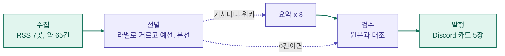
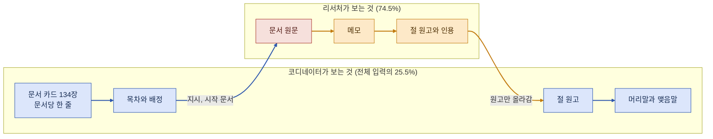
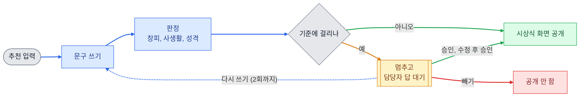

모두의연구소 AI 에이전트 과정에서 10월 27일부터 2주 동안 "에이전트 팀 꾸리기" 모듈을 들었습니다.
LangGraph라는 라이브러리로 일의 순서를 그래프로 그리고, 그 위에 에이전트를 네 개 만들었습니다.

이 글은 강의 요약이 아닙니다. 네 개를 만들면서 제가 잰 숫자와 틀렸던 곳을 적었습니다.
수업에서 짧게 지나간 원리 두 가지는 [LangGraph interrupt와 리듀서 정리](/blog/posts/langgraph-interrupt-and-reducer)에 따로 정리했습니다.

| 만든 것 | 하는 일 | 가장 기억에 남는 숫자 |
| --- | --- | --- |
| [해외 기묘한 뉴스 에이전트](https://github.com/rome777/newsletter-agent) | 매일 아침 해외 기사 약 65건에서 5건을 골라 Discord로 발행 | 요약이 금액을 10배 부풀린 카드가 실제로 나감 |
| [순살 아파트 경비봇](https://github.com/rome777/routing-agent) | 주민 문의를 분류하고 관리규약 조문에 있는 내용만 답함 | 같은 설정을 두 번 돌리면 점수가 3문항 흔들림 |
| [대항해 딥리서처](https://github.com/rome777/voyage-deep-researcher) | 문서 134건을 에이전트 여럿이 나눠 읽고 보고서 작성 | 근거율 1등 보고서가 읽어 보면 가장 약함 |
| [송년회 시상 승인 에이전트](https://github.com/rome777/award-hitl) | AI가 쓴 시상 문구 중 위험한 것만 사람에게 보냄 | 30건 중 12건만 사람이 보고 놓친 건 0 |

## 먼저 알아 둘 말

LangGraph는 일을 세 가지 재료로 그립니다. 단계들이 같이 읽고 쓰는 공용 메모장이 State, 일 하나를 하는 함수가 Node, 다음에 어디로 갈지가 Edge입니다.
뉴스레터로 치면 모은 기사와 요약 초안이 State, 수집과 선별과 발행이 Node, "고른 기사가 0건이면 요약을 건너뛴다"가 Edge입니다.

여기에 순서를 누가 정하느냐로 말이 하나 더 갈립니다.
순서를 코드에 미리 적어 두면 워크플로, 모델이 그때그때 정하면 에이전트라고 부릅니다.
수업에서 배운 패턴은 다섯 개였고, 제가 만든 것에는 이렇게 들어갔습니다.

| 패턴 | 한 줄 설명 | 내가 쓴 곳 |
| --- | --- | --- |
| 프롬프트 체이닝 | 앞 단계 결과를 다음 단계에 넘김 | 뉴스레터의 수집, 선별, 요약, 검수, 발행 |
| 라우팅 | 들어온 것을 분류해 다른 길로 보냄 | 경비봇이 문의를 6개 카테고리로 나눔 |
| 병렬화 | 같은 종류의 일을 동시에 돌림 | 뉴스레터가 기사 8건을 동시에 요약 |
| 오케스트레이터-워커 | 한 모델이 일을 쪼개 여러 워커에게 나눠 줌 | 딥리서처의 코디네이터와 리서처 |
| 평가자-최적화자 | 쓴 것을 검사하고 부족하면 다시 쓰게 함 | 경비봇이 숫자가 틀리면 한 번 다시 쓰게 함 |

## 오케스트레이터-워커 실습

패턴을 처음 손으로 고쳐 본 건 오케스트레이터-워커 실습이었습니다.
주제를 주면 한 모델이 목차를 짜고, 워커들이 섹션을 하나씩 나눠 쓰는 코드입니다.
그대로 돌리니 LangGraph 설명서에 자바스크립트 코드가 섞여 나왔습니다. 워커가 지어낸 것입니다.

| 고친 것 | 결과 |
| --- | --- |
| 워커에게 강의 노트를 같이 줌 | 지어낸 코드가 사라짐. 대신 섹션 다섯 개가 거의 같은 말을 함 |
| 워커가 노트에서 베낀 문장을 따로 내게 하고 코드로 확인 | 처음엔 노트를 통째로 베껴서 전부 통과. 한 문장으로 제한하자 다섯 중 넷이 실패 |
| 목차를 짤 때 섹션마다 다루지 않을 것을 같이 정함 | 겹침은 줄었지만 없는 기능을 또 지어냄 |
| 이어 붙이는 대신 다른 모델이 다듬게 함 | 1,147자가 1,148자로. 틀린 내용도 그대로 남음 |

여기서 얻은 기준 두 개가 뒤의 프로젝트 네 개에 계속 쓰였습니다.
지어내는 문제는 참고 자료를 줘야 고쳐지고, 겹치는 문제는 일을 나눌 때 고쳐야 합니다.
그리고 "노트대로만 써"라고 시킨 것은 코드로 확인해 보기 전까지는 지켰는지 알 수 없었습니다.

## 뉴스레터 에이전트

첫 프로젝트는 매일 아침 Discord 채널에 해외의 기묘한 뉴스 5건을 올리는 에이전트입니다.
GitHub Actions가 매일 돌리고, 기사마다 세 문장 요약과 원문에서 찾은 한 줄을 붙입니다.

<small>보라색은 모델을 부르는 단계, 초록색은 코드만 도는 단계입니다.</small>

에러가 나면 고치면 됩니다. 어려웠던 건 에러 없이 틀린 결과가 나가는 경우였습니다.

| 무슨 일이 있었나 | 원인 | 고친 방법 |
| --- | --- | --- |
| 인도 기사의 "41.39 lakh"가 4,139만 루피로 나감. 실제는 413만 9천 | 요약 모델이 단위를 틀렸고, 검수도 같은 모델이라 같이 놓침 | 본문을 넘기기 전에 코드로 숫자를 풀어 씀 |
| 한국 기사를 빼 달라고 했는데 인천 이야기가 뽑힘 | 프롬프트로 부탁만 함. 참/거짓으로 물으니 이번엔 인도 기사에 참을 붙임 | 나라 이름을 받아 코드에서 한국인지 비교 |
| 서로 다른 기사 7건이 같은 사건으로 묶여 1건만 남음 | 모델이 묶는 결과가 부를 때마다 다름 | 사건 라벨이 핵심 낱말을 공유할 때만 묶음을 믿음 |
| "할머니의 경품 쿠폰으로 SUV 당첨" 기사가 사라짐 | 광고를 거르려고 넣은 `coupon` 정규식 | 패턴에서 뺌 |

네 건 모두 발행 기록을 한 줄씩 읽다가 찾았습니다.
그래서 떨어진 기사와 떨어진 이유를 실행마다 전부 남기게 했습니다.

## 고객 응대 에이전트

두 번째 주제는 문의를 분류해서(라우팅) 근거 문서에 있는 내용만 답하게(그라운딩) 하는 에이전트입니다.

수업 실습은 가상 쇼핑몰 문의였습니다. 정답이 달린 문의 32건으로 첫 답변이 통과하는지 셌습니다.
한 번에 하나만 바꾸고, 바꿀 때마다 두 번씩 돌렸습니다.

| 바꾼 것 | 통과 (32건 중) |
| --- | --- |
| 그대로 | 17, 16 |
| 근거가 된 실제 값을 답에 적게 함 | 19, 19 |
| 고정값만 말하고 끝내지 않고 되묻게 함 | 23, 23 |
| 조회 도구가 원본 칸을 전부 돌려주게 함 | 25, 25 |
| 라우트마다 필요한 매뉴얼 장을 추가 | 28, 28 |

평균 16.5건(51.6%)에서 시작해 최종 27건(84.4%)까지 올렸습니다.
점수가 가장 크게 뛴 두 번은 프롬프트 문구가 아니라 모델에게 넘기는 자료를 바꿨을 때였습니다.

분류 쪽은 정확도 하나로는 어디가 틀렸는지 안 보였습니다. 문의 120건을 네 갈래로 나눈 결과에서 틀린 7건 중 4건이 "주문을 상품으로 착각한 칸"에 몰려 있었는데, 이건 혼동 행렬을 봐야 보입니다.
읽는 법이 헷갈려서 수업 결과를 그대로 넣은 연습장을 만들었습니다. 칸을 눌러 보면 됩니다.

  <iframe
    src="/blog/interactive/confusion-matrix.html"
    title="혼동 행렬 연습장"
    loading="lazy"
  ></iframe>

화면이 좁으면 [새 탭에서 열기](/blog/interactive/confusion-matrix.html)가 편합니다.

이 강의는 9개 절을 웹툰으로도 그렸습니다. 쇼핑몰 챗봇이 엉뚱한 답을 하다가 라우터, 조회 도구, 숫자 검사를 하나씩 얻는 이야기입니다. [전체 웹툰 보기](/blog/interactive/modumall-webtoon.html)

  
  
4강. 확신이 없으면 상담원에게 넘기는 장면

프로젝트에서는 이걸 아파트 관리규약으로 옮겼습니다.
주민 문의를 판정 전용 모델(Jev)이 여섯 카테고리로 나누고, 그 카테고리의 서울시 공동주택관리규약 준칙 조문만 꺼내 답합니다.
답 속의 숫자와 인용은 코드가 원문과 대조하고, 어긋나면 한 번 다시 쓰게 한 뒤 그래도 틀리면 상담원에게 넘깁니다.

| 설정 | 분류 정확도 | 답변 적절성 (40건) | 판정 시간 |
| --- | --- | --- | --- |
| 키워드 규칙 | 0.794 | 0.725 | 0초 |
| 판정 전용 모델 | 0.971 | 0.800 | 0.2초 |
| 위 설정에 되묻기와 넘기기 규칙을 더한 최종판 | 0.971 | 0.900, 0.850 | 0.2초 |
| 분류까지 일반 LLM으로 | 1.000 | 0.775 | 7.7초 |

이 표에서 제일 중요한 칸은 최종판의 0.900과 0.850입니다. 같은 설정을 두 번 돌린 값입니다.
다른 실험에서는 두 번의 차이가 0.075까지 벌어졌습니다. 40건 중 3건입니다.
그래서 0.05 안팎으로 오른 실험은 나아졌다고 적지 못했습니다.

채점기도 먼저 검사했습니다. 모범 답안 40건은 전부 1점, 일부러 틀린 문장을 넣은 답안 40건은 전부 0점이 나와야 통과입니다.
처음 채점기는 틀린 답안 2건에 점수를 줬고, 같은 입력에도 실행마다 판정이 달랐습니다. 여덟 번 고쳐서 통과시켰습니다.

## 딥리서치 에이전트

세 번째는 문서가 너무 많아 한 번에 못 읽을 때 쓰는 구조입니다.
대항해시대 항구 문서 134건을 모았는데, 모델이 한 번에 읽을 수 있는 양의 2.58배였습니다.
그래서 코디네이터 하나가 목차를 짜고, 리서처 여럿이 절을 하나씩 맡아 문서를 읽고 씁니다.

<small>문서 원문(빨간 칸)은 리서처 밖으로 나가지 않습니다. 코디네이터는 원고만 받습니다.</small>

누가 무엇을 읽었는지 보이게 하려고 리서처를 함대로, 문서를 항구로 그렸습니다. [데모](https://voyage-deep-researcher.onrender.com/)에서 지난 실행을 재생할 수 있습니다. 무료 서버라 첫 접속은 30초쯤 걸립니다.

장치를 하나씩 꺼 보는 실험을 48번 돌렸습니다. 비용은 209원이었습니다.
문장에 인용이 붙은 비율(근거율)로 비교했습니다.

| 조건 | 근거율 | 코디네이터가 본 비율 |
| --- | --- | --- |
| 전체 켬 | 85.2 | 25.5% |
| 다시 맡기기 끔 | 73.3 | 30.4% |
| 에이전트 하나가 혼자 읽고 씀 | 85.3 | 100% |

숫자만 보면 혼자 한 쪽과 나눠 한 쪽이 같습니다.
그런데 같은 조건을 두 번 돌리면 근거율이 평균 13.4점 움직였습니다. 이 표의 차이는 그 안에 있습니다.

그래서 보고서를 나란히 놓고 직접 읽었습니다. 문장을 누르면 그 문장이 인용한 문서 원문이 옆에 열리는 화면을 따로 만들었습니다.

근거율이 가장 높았던 혼자 쓴 보고서는 문서 한두 개로 전체를 일반화했습니다.
인용은 다 붙어 있는데 주어가 뒤바뀐 문장도 다섯 개 찾았습니다. 다섯 개 모두 연도는 원문과 맞아서 코드 검사로는 안 걸렸습니다.

지표는 명백한 실패를 거르는 데만 쓰고, 어느 보고서가 나은지는 읽어서 정했습니다.

## 사람 승인 에이전트

마지막 과제는 결과를 내보내기 전에 사람이 확인하는 단계를 넣는 것이었습니다. 영어로는 Human-in-the-loop, 줄여서 HITL이라고 합니다.

송년회 시상식을 골랐습니다. 참석자가 동료를 추천하면 AI가 상 이름과 시상 문구를 써서 화면에 올립니다.
동료들 앞에 띄운 문구는 주워 담을 수 없습니다. 그렇다고 담당자가 전부 읽으면 자동화한 의미가 없습니다.

멈추는 기준은 예시 추천 30건에 "사람이 봐야 하나" 정답을 달아 놓고 골랐습니다.

| 기준 | 사람이 보는 건 | 놓침 | 헛멈춤 |
| --- | --- | --- | --- |
| 전부 자동 | 0 | 10 | 0 |
| 창피 0.5, 사생활 0.5 | 9 | 1 | 0 |
| 창피 0.4, 사생활 0.5, 성격 판정 추가 (채택) | 12 | 0 | 2 |
| 전부 멈춤 | 30 | 0 | 20 |

놓치면 창피한 문구가 공개되고 되돌릴 수 없습니다. 헛멈춤은 담당자가 10초 읽고 승인하면 끝납니다.
그래서 놓침이 0인 기준 중에서 사람이 덜 보는 쪽을 골랐습니다.

만드는 동안 기준보다 문구 쓰는 쪽이 먼저 문제였습니다.
놀리는 추천을 넣었는데 모델이 "모범수강상"처럼 칭찬으로 바꿔 써서, 걸러야 할 4건이 그대로 통과했습니다.
반대로 칭찬 문구가 "창피"로 판정돼 13건이 헛멈춤했습니다. 판정 문장을 "창피를 당하거나 기분이 상한다"로 좁히고 예시를 넣어 5건으로 줄였습니다.

## 네 프로젝트의 공통점

네 프로젝트에서 같은 일이 계속 일어났습니다.

| 본 것 | 어디서 |
| --- | --- |
| 프롬프트로 부탁한 규칙은 지켰는지 코드로 세어 봐야 안다 | 금액 10배, 한국 기사, 칭찬으로 바뀐 놀림 |
| 한 번 돌린 점수로는 나아졌는지 말할 수 없다 | 경비봇 3문항, 딥리서처 13.4점 |
| 지표가 높다고 결과물이 좋은 건 아니다 | 근거율 1등 보고서 |
| 모델에게 넘기는 자료를 바꾸는 쪽이 문구를 바꾸는 쪽보다 효과가 컸다 | 쇼핑몰 실습 25건에서 28건 |

아직 못 한 것도 있습니다. 뉴스레터에는 평가셋이 없어서 프롬프트를 바꿀 때마다 기록을 눈으로 읽습니다.
경비봇은 두 가지를 한꺼번에 묻는 문의 3건을 끝까지 못 맞혔습니다.
딥리서처 실험은 조건마다 두 번씩만 돌려서, 장치 하나하나의 효과는 말하지 못합니다.
