10월 15일부터 23일까지는 "AI Agent 파헤치기" 모듈이었습니다.
앞 모듈이 모델에게 무엇을 넣느냐였다면, 이번에는 모델을 감싸고 있는 프로그램 쪽을 봤습니다.

| 노드 | 한 일 | 결과물 |
| --- | --- | --- |
| 자동화와 에이전트 | n8n으로 워크플로 만들기 | 스팸 문학상 워크플로 |
| 에이전트 하네스 톺아보기 | 하네스의 불편을 가설로 바꿔 실험 | [my-harness-experiment](https://github.com/rome777/my-harness-experiment) |
| 멀티에이전트 | 같은 문제를 세 방식으로 풀어 비교 | 실험 9회 집계표 |
| Openclaw, 도구 연결 | MCP 서버 붙이기, 스킬 쓰기 | Colab 실습 기록 |
| Main Quest | 사용자와 함께 만드는 카드뉴스 에이전트 | [card-news-agent](https://github.com/rome777/card-news-agent) |

## 다음 행동을 누가 정하는가

이 모듈의 첫 질문이었습니다. 같은 "자동화"라도 다음에 무엇을 할지 정하는 주체가 다릅니다.

| 방식 | 다음 행동을 정하는 쪽 | 문제가 생기면 볼 곳 |
| --- | --- | --- |
| 사람이 직접 지시 | 사람 | 입력과 판단 기준 |
| 워크플로 | 미리 연결해 둔 순서와 조건 | 어느 조건에서 다른 길로 갔는지 |
| 에이전트 | 앞 결과를 읽은 모델 | 준 도구, 도구가 돌려준 결과, 반복 한도, 승인 규칙 |

n8n으로 처음 만든 워크플로는 "스팸 문학상"이었습니다. 매일 밤 그날 온 스팸과 광고 메일을 모아 심사위원 역할의 모델이 채점하고, 매달 1일에 시상식을 엽니다.
쓸모는 없지만 워크플로가 무엇인지는 분명히 보였습니다. 접수 마감, 채점, 기록, 시상이라는 순서는 제가 정했고, 모델은 채점과 사회만 봅니다.

## 하네스

하네스는 모델을 감싸서 도구를 실행해 주고, 대화를 기억해 주고, 위험한 명령을 막아 주는 프로그램입니다. Claude Code나 Antigravity 같은 코딩 도구가 하네스입니다.
수업에서는 같은 모델 루프를 감싼 하네스 일곱 개를 열어 봤습니다.

정리가 잘 안 돼서 하네스가 조절하는 네 가지를 한 화면에 그린 학습 맵을 Antigravity로 만들었습니다. [하네스 4대 레버 학습 맵 열기](/blog/interactive/harness-four-levers.html)

과제는 "도구를 쓰면서 불편했던 점을 가설로 바꿔 실험하기"였습니다.
제 불편은 이것이었습니다. 코딩 도구에게 긴 작업을 맡기면 대화가 100턴을 넘어가면서 처음에 준 규칙을 잊습니다.

| | 내용 |
| --- | --- |
| 가설 | 규칙과 기록을 대화 밖의 파일로 빼고, 따로 도는 검사 프로그램을 붙이면 규칙 위반이 줄어든다 |
| 바꾼 것 | 규칙 파일, 전체 대화 기록 파일, 독립 검사 프로그램을 붙였는지 여부 |
| 잰 것 | 규칙 위반 횟수, 확인 안 한 숫자를 보고한 횟수 |
| 결과 | 규칙 위반 6회에서 0회, 지어낸 보고 2회에서 0회 |

이 실험은 [플루토 프로젝트](/blog/posts/pluto-starcraft-ai-league)에서 실제로 며칠씩 돌린 작업을 대상으로 했습니다.
다만 조건마다 한 번씩만 본 결과입니다. 그 뒤에 배운 기준으로 보면 반복이 부족해서, "줄었다"까지만 말할 수 있습니다.

## 멀티에이전트 실험

에이전트를 여럿 쓰면 더 잘 풀까요. 오픈소스 수학 라이브러리의 실제 버그 세 개를 세 가지 방식으로 풀게 했습니다.

| 방식 | 푼 문제 | 비용 합계 | 가장 어려운 문제에서 쓴 턴 |
| --- | --- | --- | --- |
| 에이전트 하나 | 3개 중 2개 | $0.019 | 9 |
| 코드가 순서를 정한 워크플로 | 3개 중 2개 | $0.027 | 14 |
| 리드가 워커에게 나눠 주는 방식 | 3개 중 2개 | $0.031 | 21 |

세 방식 모두 같은 두 문제를 풀고 같은 한 문제를 틀렸습니다. 달라진 건 비용뿐이었습니다.
틀린 문제는 세 방식 모두 같은 이유로 틀렸습니다. 버그의 원인은 정확히 찾았는데, 고친 결과가 테스트가 기대한 모양과 달랐습니다.

문제 세 개로 내릴 수 있는 결론은 작습니다. 그래도 "여럿이 하면 낫다"가 기본값이 아니라는 건 확인했습니다. 이 결과는 뒤에 딥리서치 에이전트를 만들 때 혼자 하는 대조군을 꼭 넣게 된 이유입니다.

## 도구 연결

MCP는 모델이 쓸 도구를 표준 방식으로 붙이는 규격입니다. 실습에서는 Colab 노트북을 MCP 서버로 붙여서, 제 PC의 에이전트가 Colab의 GPU에서 코드를 돌리게 했습니다.
연결 주소가 60초 안에 사라져서 몇 번을 다시 했습니다.

Openclaw는 직접 깔아서 성격이 다른 에이전트 둘을 만들어 봤습니다. 설정 파일 몇 개로 에이전트의 역할과 기억이 정해지는 구조를 봤습니다.

## 카드뉴스 에이전트

모듈의 마지막 과제입니다. 주제를 적으면 최근 뉴스를 찾아 그림 카드 여러 장으로 정리해 줍니다. [직접 써 보기](https://card-news-agent.onrender.com) (무료 서버라 처음 열 때 1분쯤 걸립니다)

  
  
  
  
주제에 "프랑스 시위"만 적고 만든 카드 7장 중 3장

과제 이름에 "사용자와 함께"가 붙어 있습니다. 에이전트가 혼자 끝까지 가지 않고 중간에 사람에게 묻습니다.

```mermaid
flowchart LR
    T["주제 입력"] --> S["뉴스 찾기"]
    S --> P1{{"사람: 뉴스 1~3개 고르기"}}
    P1 --> Q{{"사람: 필요할 때만 질문에 답"}}
    Q --> D["카드 기획"]
    D --> P2{{"사람: 기획 승인 또는 수정 요청"}}
    P2 --> I["그림 그리고 글자 얹기"]
    I --> P3{{"사람: 살펴보고 고치기, 최종 승인"}}
    P3 --> Z["ZIP 내려받기"]

    classDef ai fill:#dbeafe,stroke:#2563eb,color:#1e3a8a
    classDef human fill:#fef3c7,stroke:#d97706,color:#78350f
    class T,S,D,I,Z ai
    class P1,Q,P2,P3 human
    linkStyle 0,1,2,3,4,5,6,7 stroke:#2563eb,stroke-width:2px
```

<small>노란 칸에서는 앱이 멈춰서 사람을 기다립니다.</small>

하루 동안 조사와 원고를 쓰는 엔진을 세 번 바꿨습니다.

| 순서 | 엔진 | 바꾼 이유 |
| --- | --- | --- |
| 1 | Claude CLI | 제 PC에 로그인돼 있어서 바로 쓸 수 있었음 |
| 2 | OpenAI API | 서버에 올리려면 CLI 로그인이 아니라 API 키가 필요함 |
| 3 | Gemini API | 그림 모델을 마음에 든 그림체 쪽으로 맞추면서 키 하나로 통일 |

엔진을 바꿀 때마다 앞 엔진은 옵션으로 남겨 뒀습니다. 이미 확인한 길을 지우지 않기 위해서였습니다.

그림은 꼭 눈으로 확인해야 했습니다. 프랑스 시위 기사인데 다른 나라 의사당처럼 생긴 돔 건물을 그리는 일이 있었습니다.
기획 프롬프트에 "다른 나라 건물로 오해받을 모양 금지"를 넣었고, 화면에는 그림만 다시 만드는 버튼을 뒀습니다.

비밀번호 없이 공개해서 비용 상한도 걸었습니다. 서버 전체로 하루 30편, 같은 접속 주소에서는 하루 1편입니다.

## 이 모듈에서 가져간 것

| 가져간 것 | 나중에 쓴 곳 |
| --- | --- |
| 규칙과 기록은 대화 밖 파일에 둔다 | 플루토, 그 뒤 모든 프로젝트의 규칙 파일 |
| 여럿이 하는 방식에는 혼자 하는 대조군을 붙인다 | 딥리서치 에이전트의 소거 실험 |
| 사람이 끼어드는 자리를 흐름에 그려 넣는다 | 사람 승인 에이전트 |

다음 모듈에서는 이 흐름을 [LangGraph로 직접 그렸습니다](/blog/posts/agent-team-wrap-up).
