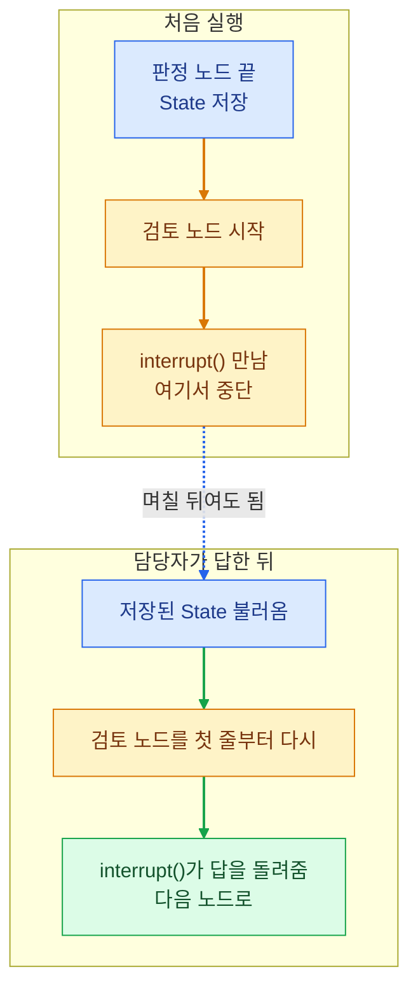

[LangGraph로 에이전트 네 개를 만든 2주 정리](/blog/posts/agent-team-wrap-up)에서 이어지는 글입니다.
만들 때는 "이렇게 쓰면 된다"로 넘어갔던 두 가지를 다시 찾아봤습니다.

| 궁금했던 것 | 어디서 썼나 |
| --- | --- |
| 멈춘 그래프는 껐다 켜도 어떻게 이어지나 | 위험한 시상 문구만 담당자에게 보내는 승인 에이전트 |
| 워커 여럿이 같은 칸에 동시에 쓰면 어떻게 되나 | 기사 8건을 동시에 요약하는 뉴스레터, 문서를 나눠 읽는 딥리서처 |

## interrupt로 멈춘 그래프가 이어지는 방식

사람 승인 단계를 넣을 때 `interrupt()`를 부르면 그래프가 멈추고, 사람이 답하면 이어진다고 배웠습니다.
만들다 보니 궁금한 게 생겼습니다. 프로그램을 껐다 켜도 이어지는데, 그럼 멈춘 자리의 변수는 어디에 있었을까요.

찾아보니 멈춘 자리를 기억하는 게 아니었습니다. LangGraph는 노드가 끝날 때마다 State를 저장소(체크포인터)에 적어 둡니다.
`interrupt()`를 만나면 그 노드를 버리고 멈춥니다. 다시 시작하면 그 노드를 첫 줄부터 다시 실행하고, 이번에는 `interrupt()`가 멈추지 않고 사람의 답을 돌려줍니다.

이걸 알고 나니 설계가 두 군데 바뀌었습니다.

- 검토 노드에는 `interrupt()` 말고 아무것도 두지 않았습니다. 그 앞에 알림 보내기 같은 걸 두면 재개할 때 한 번 더 나갑니다.
- 공개는 노드 하나에서만 하고, 추천 번호로 덮어쓰게 했습니다. 혹시 두 번 실행돼도 상이 두 번 올라가지 않습니다.

실제로 4건을 멈춰 세운 채 프로그램을 끄고 다시 켜 봤습니다. 4건 모두 대기 상태로 남아 있었고, 넣은 답대로 처리됐습니다. 저장소를 메모리가 아니라 파일(SQLite)로 둔 덕입니다.

## 병렬 워커의 결과를 합치는 리듀서

뉴스레터는 기사 8건을 동시에 요약하고, 딥리서처는 리서처 여럿이 동시에 씁니다.
여럿이 State의 같은 칸에 동시에 쓰면 어떻게 될까요.

기본 동작은 덮어쓰기입니다. 그래서 두 노드가 같은 단계에서 같은 칸에 쓰면 LangGraph가 에러를 냅니다. 어느 쪽을 남길지 모르기 때문입니다.
칸에 "합치는 방법"을 붙여 두면 달라집니다. 이걸 리듀서라고 합니다.

| State 칸 | 합치는 방법 | 워커 셋이 쓴 뒤 |
| --- | --- | --- |
| `draft: str` | 없음 (덮어쓰기) | 에러 |
| `drafts: Annotated[list, operator.add]` | 리스트 이어 붙이기 | 세 개가 모두 들어 있음 |

워커를 몇 개 띄울지는 실행 중에 정해집니다. 기사가 8건이면 8개, 3건이면 3개입니다.
그래서 엣지를 미리 그어 두지 않고, `Send`로 "이 노드를 이 입력으로 하나 더 띄워"를 그때 만들어 보냅니다.

이 구조에서 실제로 걸렸던 일이 있습니다.

- 워커 수를 제한하려고 워커를 띄우는 함수에서 "몇 개 잘랐는지"를 적으려 했는데 안 됐습니다. 그 함수는 갈 곳만 돌려줄 수 있고 State에는 못 씁니다. 자른 개수는 앞 노드에서 적었습니다.
- 딥리서처에서 같은 절의 원고가 두 번 올라오면 나중 것이 먼저 것을 지웠습니다. 인용을 빠뜨린 두 번째 원고가 멀쩡한 첫 원고를 덮어쓴 겁니다. 실제로 읽은 문서를 가리키는 인용이 더 많은 쪽을 남기게 바꿨습니다.

## 정리

| 원리 | 그래서 바꾼 것 |
| --- | --- |
| 재개하면 멈춘 노드를 첫 줄부터 다시 실행한다 | 멈추는 노드에는 바깥으로 나가는 일을 두지 않음 |
| 같은 칸에 동시에 쓰면 에러, 리듀서가 있으면 합쳐진다 | 워커 결과를 받는 칸은 리스트로 두고 이어 붙임 |
| 나중 값이 먼저 값을 덮어쓸 수 있다 | 두 번째 원고는 인용 수를 비교해서 남김 |

두 가지 모두 LangGraph 공식 문서의 [interrupt](https://docs.langchain.com/oss/python/langgraph/interrupts)와 [Graph API](https://docs.langchain.com/oss/python/langgraph/graph-api) 설명, 그리고 [동시 쓰기 에러 안내](https://docs.langchain.com/oss/python/langgraph/errors/INVALID_CONCURRENT_GRAPH_UPDATE)를 읽고, 제 코드에서 실제로 그렇게 도는지 확인한 내용입니다.
