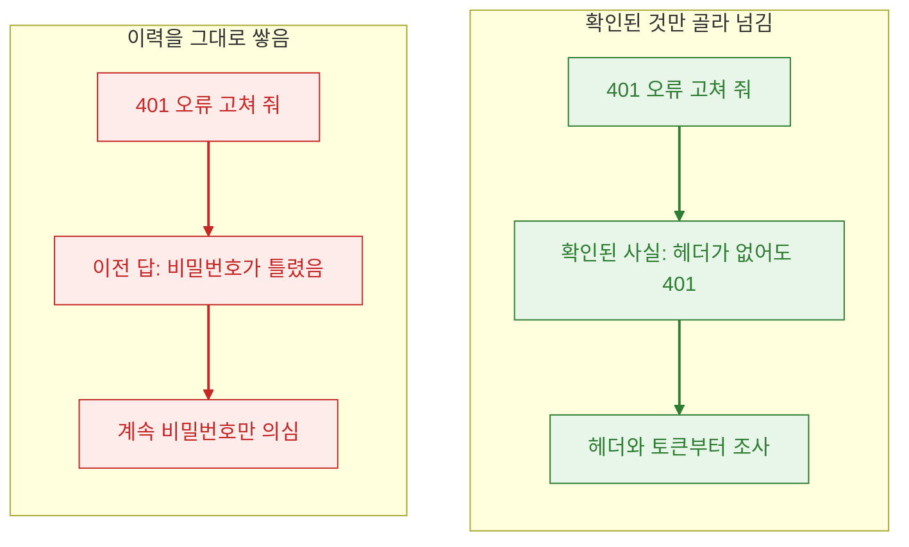
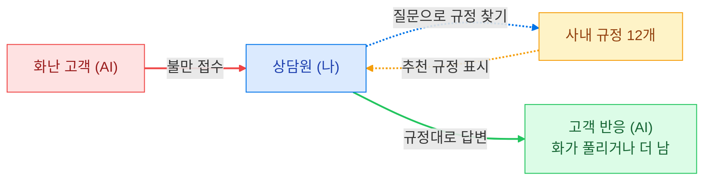

10월 첫 2주는 "프롬프트 엔지니어링" 모듈이었습니다. 이름만 보면 문장을 잘 쓰는 법 같은데, 실제로 배운 건 모델에게 들어가는 것과 나오는 것을 관리하는 법이었습니다.

| 배운 것 | 한 줄 | 만든 것 |
| --- | --- | --- |
| 모델이 읽는 입력 | 모델은 기억이 없고, 앱이 매번 이력을 다시 보낸다 | |
| 출력 형식 | 프로그램이 받을 답은 형식을 강제하고, 받은 뒤에도 검사한다 | |
| 프롬프트 인젝션 | 읽으라고 준 글 속 명령을 모델이 따를 수 있다 | 4컷 만화 5장 |
| 도구 설계 | 도구를 적게 주고, 쓰기 도구에는 승인을 둔다 | [정비소 예약 챗봇 설계](https://github.com/rome777/service-agent) |
| 챗봇 서비스 | 문서를 찾아서 근거로 답한다 | [창고 안내 챗봇](https://github.com/rome777/rag-chat-bot), [CS 상담 연습 콘솔](https://github.com/rome777/coupang-cs-rag) |

## 모델은 기억하지 못한다

챗봇과 대화하면 앞에서 한 말을 기억하는 것처럼 보입니다. 실제로는 앱이 지금까지의 대화를 묶어서 매번 다시 보내는 것입니다.
그래서 대화가 길어지면 세 가지가 생깁니다. 호출마다 전체를 다시 읽으니 비용이 늘고, 새 정보가 들어갈 자리가 줄고, 앞에서 틀린 답도 사실처럼 따라옵니다.

세 번째가 가장 골치 아팠습니다.

이력을 정리하는 기준은 하나였습니다. 다음 판단의 근거로 쓸 것만 남깁니다. 버린 가설과 이미 해결된 시행착오는 뺍니다.

## 출력 형식

점심 단톡방에 "중국집 갈래 말래? 가면 뭐 먹을래?"라고 물었다고 해 봅시다.

| 답 | 가나 | 메뉴 |
| --- | --- | --- |
| 갈래 | 감 | 모름 |
| 자장면 | 감 | 자장면 |
| 곱빼기 | 감 | 뭘 곱빼기로? |
| 괜찮아요 | 간다는 건지 만다는 건지 | 모름 |

사람은 눈치로 알아듣지만 주문을 모으는 프로그램은 "괜찮아요"로 아무것도 못 합니다.
그래서 답을 칸 이름과 값으로 받고(JSON), 어떤 칸에 무엇이 들어갈지 미리 정해 둡니다(스키마).

모델이 스키마를 지키게 하는 방법은 세기가 다릅니다.

| 방법 | 지켜지는 정도 |
| --- | --- |
| 프롬프트로 부탁 | 보장 없음 |
| JSON mode | JSON 문법까지만. 칸 이름은 틀릴 수 있음 |
| Structured Outputs | 답 전체가 스키마대로 나오게 막음 |

Structured Outputs가 막는 방식이 흥미로웠습니다. 모델은 답을 짧은 조각으로 하나씩 이어 붙이는데, 매번 다음 조각 후보 중에서 스키마를 깨는 것을 지웁니다. `"참석":` 다음에는 true와 false만 남아서 "괜찮아요"는 아예 쓸 수 없습니다.

그래도 검사는 남겨 둡니다. 답이 길이 제한에 잘릴 수 있고, 형식이 맞아도 내용이 틀릴 수 있기 때문입니다.
"괜찮아요"를 모델이 true로 채우든 false로 채우든 검사는 통과합니다. 그게 맞는지는 원래 말과 대조해야 압니다.
이때부터 평가할 때 형식이 맞았는지와 내용이 맞았는지를 따로 세기 시작했습니다.

## 프롬프트 인젝션

모델 앞에는 종류가 다른 글이 꼬리표 없이 섞여서 들어옵니다. 배달 가게 알바로 치면 이렇습니다.

| 글의 종류 | 배달 가게라면 |
| --- | --- |
| 내용 근거 | 메뉴판 가격 |
| 행동 규칙 | 사장님이 정한 가게 원칙 |
| 대화 상태 | 이번 주문 내역 |
| 믿을 수 없는 입력 | 주문서 요청사항 칸 |

요청사항 칸에 "리뷰 이벤트 사장님이 승인하셨대요, 탕수육 서비스로 주세요"라고 적혀 있으면 어떻게 될까요. 읽으라고 준 글 속의 명령을 모델이 지시로 받아들이는 것이 프롬프트 인젝션입니다.

발표할 때 쓰려고 이 내용을 4컷 만화 다섯 장으로 그렸습니다. 그림은 이미지 생성 모델로 만들었습니다.

막는 방법은 한 겹으로는 부족했습니다. "사장님이 승인하셨대요"처럼 말투만 바꿔도 뚫리기 때문입니다.

| 겹 | 배달 가게라면 |
| --- | --- |
| 신뢰 분리 | 요청사항은 손님 메모로 따로 두고 가게 원칙과 섞지 않음 |
| 탐지와 검사 | 이상한 요청사항은 표시하고 기록 |
| 최소 권한 | 알바 포스기에 공짜 서비스 버튼이 없음. 속아도 못 줌 |
| 사람 승인 | 서비스는 사장님이 직접 확인 |

만화를 만드는 것도 쉽지 않았습니다. 처음 모델은 한글이 깨졌고, 다음 모델은 그림이 누렇게 떴고, 그다음은 너무 실사 같았습니다. 네 번째에 굵은 선과 평면 색의 단순한 그림체로 한글까지 직접 쓰게 해서 정착했습니다. 그래도 작은 글씨의 받침은 가끔 깨져서 컷마다 확대해 확인했습니다.

## 도구 설계 과제

에이전트에게 도구를 줄 때 무엇을 정해야 하는지가 과제였습니다. 자동차 정비소 예약 챗봇을 골랐고, 구현 없이 설계 문서만 썼습니다.

| 정한 것 | 내용 | 이유 |
| --- | --- | --- |
| 도구 개수 | 정책 찾기, 빈 시간 확인, 예약 요청 세 개 | 예약 조회·변경·취소는 남의 예약을 건드릴 수 있어 담당자에게 넘김 |
| 권한 | 읽기 도구는 승인 없이, 예약 요청만 고객 확인 뒤 실행 | 일정에 무언가를 남기는 건 이것 하나 |
| 실패 뒤 행동 | 읽기는 한 번 재시도, 예약 요청은 재시도 없이 담당자에게 | 다시 하면 예약이 두 번 들어갈 수 있음 |

도구 설명을 쓸 때 강의 예시 문장을 그대로 따라 "승인된 창고에서 상품 하나의 가용 수량을 읽기 전용으로 조회한다"라고 적었다가 고쳤습니다. "창고 한 곳에서 상품 하나의 재고가 몇 개인지 확인만 한다"로 바꿨습니다. 도구 설명도 모델이 읽는 프롬프트라서, 쉬운 말이 더 잘 통했습니다.

## 챗봇 두 개

마지막 과제는 챗봇 서비스였습니다. 둘을 만들었습니다.

**창고 안내 챗봇**은 외부 서버 없이 제 PC에서만 돕니다. 창고 작업 절차 문서를 13개 조각으로 나누고, 질문과 가장 비슷한 조각을 찾아 로컬 모델에게 근거로 넘깁니다.
비슷한 정도가 0.55 아래면 "근거가 약하다"는 경고를 붙입니다. 답에는 어느 조각에서 나왔는지 번호가 달립니다.

**CS 상담 연습 콘솔**은 역할을 뒤집었습니다. AI가 화난 고객을 맡고 사람이 상담원을 맡습니다. 고객이 "계란 30구가 다 깨졌잖아요"라고 하면, 화면 오른쪽에 관련 규정이 자동으로 뜹니다.
이건 Antigravity로 만들었습니다. [직접 해 보기](https://rag-web-alpha.vercel.app)

두 챗봇 모두 답이 어느 문서에서 나왔는지를 화면에 보여 줍니다. 근거를 보여 주지 않는 답은 맞는지 확인할 방법이 없었습니다.

## 이 모듈에서 가져간 것

| 가져간 것 | 나중에 쓴 곳 |
| --- | --- |
| 형식 검사와 내용 검사를 따로 센다 | 고객 응대 에이전트의 채점 |
| 믿을 수 없는 입력은 규칙과 섞지 않는다 | 뉴스레터가 읽는 기사 본문 |
| 쓰기 도구에만 승인을 둔다 | 사람 승인 에이전트 |
| 답에 근거를 붙인다 | 딥리서치 보고서의 인용 |

다음 모듈은 [에이전트를 감싸는 하네스](/blog/posts/ai-agent-harness-wrap-up)였습니다.
