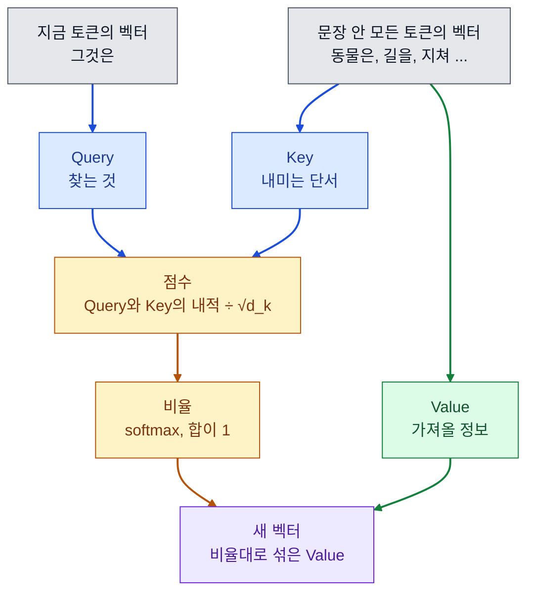
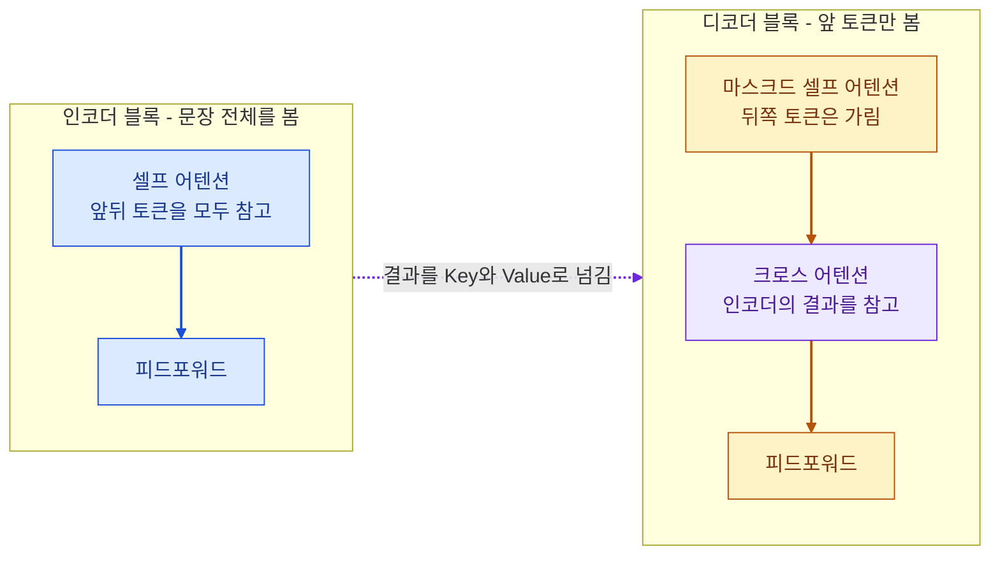
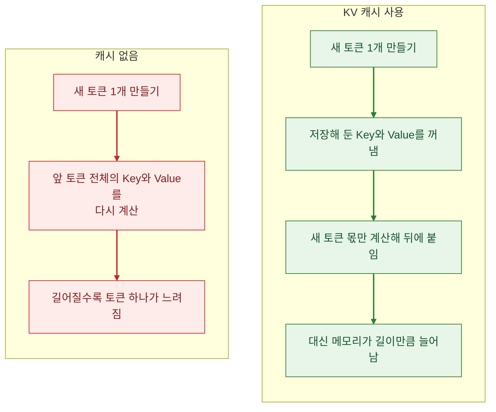

9월에 트랜스포머를 배울 때는 도서관에서 책을 찾는 비유로 이해하고 넘어갔습니다.
누가 "셀프 어텐션이 뭔가요?"라고 물으면 비유만으로는 답이 되지 않습니다. 그래서 나올 만한 질문 11개를 고르고, 질문마다 먼저 할 한두 문장을 정해 두었습니다.

읽는 순서는 이렇습니다.

- 왼쪽에 줄이 그어진 칸이 먼저 할 답입니다. 결론부터 말하고, 더 물으면 그 아래 내용으로 이어 갑니다.
- 표에는 이어서 나올 만한 꼬리 질문을 적었습니다.
- 글 끝에 답을 가리고 연습하는 카드가 있습니다.

맨 위 그림은 Q3에서 설명하는 셀프 어텐션의 예시입니다.

## 먼저 알아 둘 말

| 말 | 뜻 |
| --- | --- |
| 토큰 | 모델이 글을 쪼개 읽는 단위. 단어보다 작은 조각일 때가 많습니다 |
| 벡터 | 숫자 여러 개를 한 줄로 늘어놓은 것. 토큰 하나가 벡터 하나로 바뀌어 모델에 들어갑니다 |
| 어텐션 | 한 토큰이 다른 토큰들을 얼마나 참고할지 점수로 정해서 정보를 섞는 계산 |
| 블록 | 어텐션과 그 뒤에 붙는 작은 신경망(피드포워드)을 묶은 한 단위. 이 묶음을 여러 번 쌓아 모델을 만듭니다 |
| 내적 | 두 벡터의 같은 자리 숫자끼리 곱해서 모두 더한 값. 두 벡터가 비슷한 방향일수록 큽니다 |
| 기울기 | 학습할 때 값을 어느 쪽으로 얼마나 고칠지 알려 주는 신호 |

## 등장 배경

### Q1. 트랜스포머를 한 문장으로 설명해 보세요

> 어텐션만으로 문장 안 모든 토큰의 관계를 한꺼번에 계산하는 신경망 구조입니다. 2017년에 번역 모델로 나왔고, 지금 쓰는 LLM은 대부분 이 구조를 쌓아 만듭니다.

그 전까지 문장을 다루는 모델은 토큰을 앞에서부터 하나씩 읽었습니다. 이 방식을 RNN이라고 합니다. 트랜스포머는 순서대로 읽는 부분을 빼고 어텐션만 남겼습니다. 논문 제목이 「Attention Is All You Need」인 것도 그래서입니다.

| 꼬리 질문 | 답 |
| --- | --- |
| 어디에 쓰이나요? | 번역에서 시작해 GPT와 BERT 같은 언어 모델로, 이미지와 음성으로 넓어졌습니다 |
| 무엇으로 이루어져 있나요? | 토큰 임베딩, 위치 정보, 어텐션, 피드포워드, 잔차 연결과 정규화입니다 |

### Q2. RNN 대신 트랜스포머를 쓰는 이유는 무엇인가요?

> 문장을 순서대로 읽지 않기 때문에 학습을 병렬로 돌릴 수 있고, 멀리 떨어진 단어도 한 번에 연결됩니다.

RNN은 앞 토큰의 계산이 끝나야 다음 토큰을 계산합니다. 문장 길이만큼 차례를 기다려야 해서 GPU가 있어도 한꺼번에 계산할 수 없습니다. 첫 단어의 정보가 마지막 단어에 닿으려면 그 단계를 전부 지나야 해서, 문장이 길면 앞 내용이 흐려집니다.

트랜스포머는 모든 토큰 쌍을 어텐션으로 바로 잇습니다. 논문은 둘을 이렇게 비교했습니다.

| 비교 | RNN | 셀프 어텐션 |
| --- | --- | --- |
| 차례로 해야 하는 계산 | 문장 길이만큼 | 1번 |
| 가장 먼 두 토큰 사이의 단계 | 문장 길이만큼 | 1단계 |
| 계산량 | 길이 × 벡터 크기² | 길이² × 벡터 크기 |

| 꼬리 질문 | 답 |
| --- | --- |
| 단점은 무엇인가요? | 계산량과 메모리가 토큰 수의 제곱으로 늘어납니다. 순서 정보가 없어서 따로 넣어 줘야 합니다 |
| LSTM으로는 해결되지 않았나요? | 앞 내용이 흐려지는 문제는 줄였습니다. 순서대로 계산하는 구조는 그대로라 병렬로 돌릴 수 없었습니다 |

## 어텐션

### Q3. 셀프 어텐션은 어떻게 계산하나요?

> 토큰마다 Query를 만들어 문장 안 모든 토큰의 Key와 점수를 매깁니다. 그 점수를 합이 1인 비율로 바꾸고, 비율대로 Value를 섞어 새 벡터를 만듭니다.

```text
Attention(Q, K, V) = softmax( Q·Kᵀ / √d_k ) · V
```

Q, K, V는 같은 토큰 벡터에 서로 다른 행렬을 곱해 만든 세 벌입니다. 수업에서는 도서관에 빗대 배웠습니다.

| 이름 | 도서관으로 치면 | 하는 일 |
| --- | --- | --- |
| Query | 내가 들고 온 질문 카드 | 지금 토큰이 찾는 것 |
| Key | 책마다 붙은 색인표 | 다른 토큰이 내미는 단서 |
| Value | 책의 내용 | 참고하기로 한 토큰에서 가져올 정보 |



"동물은 길을 건너지 않았다. 그것은 너무 지쳐 있었다"라는 문장에서 '그것은'의 Query는 '동물은'의 Key와 점수가 높게 나오도록 학습됩니다. 그래서 '그것은'의 새 벡터에는 '동물은'의 정보가 많이 섞입니다.

| 꼬리 질문 | 답 |
| --- | --- |
| √d_k로 나누는 이유는 무엇인가요? | 벡터에 든 숫자가 많을수록 내적 값이 커집니다. 그러면 softmax가 한 토큰에만 쏠리고 기울기가 아주 작아져서 학습이 잘 안 됩니다. 값의 크기를 줄여 주는 장치입니다 |
| 왜 "셀프"라고 부르나요? | Q, K, V가 모두 같은 문장에서 나오기 때문입니다. Q는 디코더에서, K와 V는 인코더에서 오면 크로스 어텐션입니다 |
| softmax는 왜 쓰나요? | 점수를 합이 1인 비율로 바꿔야 Value의 가중 평균을 낼 수 있습니다 |

### Q4. 멀티 헤드 어텐션은 왜 쓰나요?

> 어텐션을 여러 벌 나란히 돌려서, 한 문장을 여러 관점으로 동시에 보게 합니다.

어텐션이 한 벌뿐이면 주어와 동사의 관계, 대명사가 가리키는 말 같은 서로 다른 관계가 비율 하나로 평균돼 버립니다. 헤드마다 Q, K, V를 만드는 행렬이 달라서 헤드마다 다른 관계를 보게 됩니다. 헤드들의 결과는 이어 붙여 하나로 합칩니다.

논문의 기본 모델은 크기 512인 벡터를 헤드 8개가 64씩 나눠 씁니다. 그래서 헤드가 여러 개여도 전체 계산량은 한 벌일 때와 비슷합니다.

| 꼬리 질문 | 답 |
| --- | --- |
| 헤드를 늘리면 계속 좋아지나요? | 헤드 하나가 쓰는 크기가 그만큼 줄어듭니다. 그래서 모델 크기와 함께 정합니다 |
| MQA와 GQA는 무엇인가요? | 생성할 때 저장해 두는 Key와 Value를 헤드끼리 나눠 써서 메모리를 줄이는 방식입니다. MQA는 한 벌을 모든 헤드가 쓰고, GQA는 헤드를 몇 묶음으로 나눠 묶음마다 한 벌씩 씁니다 |

### Q5. 위치 인코딩은 왜 필요한가요?

> 어텐션 계산에는 순서가 들어 있지 않습니다. 그래서 토큰이 몇 번째인지를 따로 넣어 줍니다.

Query와 Key의 점수는 두 토큰의 내용만 보고 정해집니다. 위치 정보가 없으면 단어를 어떤 순서로 넣어도 같은 단어는 같은 결과를 받습니다. 영어로 치면 "dog bites man"과 "man bites dog"를 구별하지 못합니다.

원 논문은 위치마다 다른 sin과 cos 파형을 임베딩에 더했습니다. 위치 값을 학습시키는 방식도 실험했는데 결과는 거의 같았다고 적혀 있습니다. 요즘 LLM은 상대 위치를 넣는 방식을 많이 씁니다.

| 방식 | 넣는 정보 | 예 |
| --- | --- | --- |
| 절대 위치 | 몇 번째 토큰인가 | sin과 cos 파형, 학습하는 위치 임베딩 |
| 상대 위치 | 두 토큰이 몇 칸 떨어졌나 | Query와 Key를 위치만큼 회전(RoPE), 멀수록 점수를 깎음(ALiBi) |

| 꼬리 질문 | 답 |
| --- | --- |
| 상대 위치를 쓰는 이유는 무엇인가요? | 학습 때 본 것보다 긴 문장이 들어와도 잘 버티게 하려는 것입니다 |
| 위치 정보는 어디에 넣나요? | 원 논문은 입력 임베딩에 더합니다. RoPE와 ALiBi는 어텐션 점수를 계산하는 자리에서 넣습니다 |

## 구조

### Q6. 인코더와 디코더는 무엇이 다른가요?

> 인코더는 입력 문장 전체를 앞뒤로 다 보고, 디코더는 앞에 나온 토큰만 보면서 다음 토큰을 하나씩 만듭니다.

디코더가 뒤쪽 토큰까지 보면 정답을 미리 보는 셈입니다. 그래서 뒤쪽 토큰의 점수를 가립니다. 이것을 마스크라고 합니다. 원래의 번역 모델에서는 디코더가 크로스 어텐션으로 인코더의 결과를 참고했습니다.



<small>GPT처럼 디코더만 쌓은 모델에는 가운데의 크로스 어텐션이 없습니다.</small>

| 꼬리 질문 | 답 |
| --- | --- |
| BERT와 GPT는 어떻게 다른가요? | BERT는 인코더만 쌓고 가린 단어를 맞히며 학습합니다. 분류나 검색용 임베딩처럼 문장을 이해하는 일에 씁니다. GPT는 디코더만 쌓고 다음 토큰을 맞히며 학습합니다. 글을 만드는 일에 씁니다 |
| 마스크는 어떻게 만드나요? | 뒤쪽 토큰의 점수를 아주 큰 음수로 바꿉니다. softmax를 지나면 그 토큰의 비율이 0이 됩니다 |
| 요즘 LLM이 디코더만 쓰는 이유는 무엇인가요? | 다음 토큰 맞히기 하나로 번역과 요약 같은 과제를 모두 글 생성으로 풀 수 있기 때문입니다 |

### Q7. 블록 하나 안에는 무엇이 들어 있나요?

> 어텐션과 피드포워드 두 부분이 있고, 두 부분 모두에 잔차 연결과 정규화가 붙어 있습니다.

| 부품 | 하는 일 |
| --- | --- |
| 어텐션 | 토큰끼리 정보를 섞습니다 |
| 피드포워드 | 섞인 결과를 토큰마다 따로 한 번 더 변환합니다 |
| 잔차 연결 | 입력을 출력에 그대로 더합니다. 블록을 많이 쌓아도 신호가 끊기지 않습니다 |
| 층 정규화 | 벡터 값의 크기를 고르게 맞춥니다. 학습이 덜 흔들립니다 |

| 꼬리 질문 | 답 |
| --- | --- |
| 정규화는 어디에 두나요? | 원 논문은 입력을 더한 뒤에 정규화합니다(Post-LN). 이후 모델은 어텐션과 피드포워드 앞에 두는 경우가 많습니다(Pre-LN). 깊게 쌓아도 학습이 안정적이기 때문입니다 |
| 배치 정규화를 쓰지 않는 이유는 무엇인가요? | 문장마다 길이가 달라서 배치로 낸 통계가 흔들립니다. 층 정규화는 토큰 하나 안에서 계산해서 배치와 상관이 없습니다 |

## 학습과 생성

### Q8. 학습할 때와 생성할 때는 계산이 어떻게 다른가요?

> 학습할 때는 정답 문장을 통째로 넣고 모든 자리의 다음 토큰을 한 번에 맞히게 합니다. 생성할 때는 토큰을 하나 뽑아 입력 뒤에 붙이고 다시 계산하는 일을 반복합니다.

| 구분 | 학습 | 생성 |
| --- | --- | --- |
| 입력 | 정답 문장 전체 | 지금까지 만든 토큰 |
| 계산 | 모든 자리를 한 번에. 마스크로 뒤쪽을 가립니다 | 토큰 하나마다 한 번 |
| 속도 | 병렬이라 빠릅니다 | 길이만큼 반복해서 느립니다 |

| 꼬리 질문 | 답 |
| --- | --- |
| temperature는 무엇인가요? | 다음 토큰의 확률 분포를 뾰족하게 또는 평평하게 만드는 값입니다. 낮추면 확률이 높은 토큰만 뽑혀서 답이 비슷하게 나옵니다 |
| top-p는 무엇인가요? | 확률이 높은 후보부터 더해서 합이 p가 될 때까지만 후보로 남기는 방식입니다 |
| 같은 질문에 답이 달라지는 이유는 무엇인가요? | 다음 토큰을 확률에 따라 뽑기 때문입니다 |

### Q9. KV 캐시는 무엇인가요?

> 생성할 때 앞 토큰들의 Key와 Value를 저장해 두고, 새 토큰 것만 계산해서 이어 붙이는 방법입니다.



이미 지나간 토큰의 Key와 Value는 바뀌지 않습니다. 캐시가 없으면 토큰을 하나 만들 때마다 그 값을 전부 다시 계산합니다. 저장해 두면 새 토큰 몫만 계산하면 됩니다.

| 꼬리 질문 | 답 |
| --- | --- |
| 학습할 때도 쓰나요? | 쓰지 않습니다. 생성할 때만 씁니다 |
| 프롬프트 캐싱과는 어떤 관계인가요? | API의 프롬프트 캐싱은 요청의 앞부분이 이전 요청과 같으면 그 부분을 다시 계산하지 않게 해 주는 기능입니다. 그래서 바뀌지 않는 내용을 프롬프트 앞에 둡니다 |

[딥리서치 에이전트](/blog/posts/agent-team-wrap-up)를 만들 때 이것을 썼습니다. 매번 같은 문서 카드와 원문을 프롬프트 앞에 두고 매번 다른 질문과 지시를 뒤에 두었더니, 48번 실행에서 입력의 74%가 캐시에 맞았습니다.

### Q10. 문맥이 길어지면 무엇이 문제인가요?

> 어텐션이 모든 토큰 쌍을 계산하기 때문에 비용이 토큰 수의 제곱으로 늘어납니다. 그리고 긴 입력의 가운데에 있는 정보는 모델이 잘 쓰지 못합니다.

입력이 두 배가 되면 어텐션 계산은 네 배가 됩니다. 컨텍스트 창에 들어간다고 해서 전부 잘 읽는 것도 아닙니다. 필요한 정보가 입력의 처음이나 끝에 있을 때 성능이 가장 좋고 가운데에 있으면 크게 떨어진다는 연구가 있습니다.

뉴스레터 에이전트에서 후보 기사 65건을 한 프롬프트에 넣지 않고 40건 이하 묶음으로 나눠 고르게 한 것도 이 때문이었습니다.

| 꼬리 질문 | 답 |
| --- | --- |
| 컨텍스트 창은 무엇인가요? | 모델이 한 번에 받을 수 있는 토큰 수의 한도입니다 |
| 어떻게 대응하나요? | 필요한 것만 찾아서 넣습니다. 지난 대화는 요약하고, 중요한 내용은 앞이나 뒤에 둡니다. 양이 많으면 여러 번으로 나눠 처리합니다 |

### Q11. 트랜스포머는 이미지에도 쓰나요?

> 네. 이미지를 작은 조각으로 잘라 토큰처럼 넣으면 같은 구조를 그대로 쓸 수 있습니다.

ViT라는 모델은 이미지를 16×16 픽셀 조각으로 잘라 문장의 단어처럼 다룹니다. 큰 데이터로 미리 학습시키면 CNN과 비슷하거나 더 나은 결과가 나옵니다.

| 꼬리 질문 | 답 |
| --- | --- |
| CNN보다 불리한 점은 무엇인가요? | 데이터가 적을 때 불리합니다. CNN은 가까운 픽셀끼리 묶어 본다는 가정이 구조에 들어 있습니다. 트랜스포머는 그것까지 데이터에서 배워야 합니다 |
| 객체 탐지에도 쓰나요? | 씁니다. DETR이라는 모델은 물체 목록을 한 번에 예측해서, 겹친 박스를 지우는 후처리가 필요 없습니다 |

## 연습 카드

질문만 보고 30초 안에 소리 내어 답해 본 뒤 답을 열어 맞춰 봅니다. 막힌 질문은 따로 모아 다시 볼 수 있습니다.

<div class="embed-frame">
  <iframe
    src="/blog/interactive/question-cards.html?post=transformer-questions"
    title="트랜스포머 연습 카드"
    loading="lazy"
    style="height: 420px"
  ></iframe>
</div>

[새 탭에서 열기](/blog/interactive/question-cards.html?post=transformer-questions)

## 출처

- [Attention Is All You Need](https://arxiv.org/abs/1706.03762)
- [BERT: Pre-training of Deep Bidirectional Transformers for Language Understanding](https://arxiv.org/abs/1810.04805)
- [RoFormer: Enhanced Transformer with Rotary Position Embedding](https://arxiv.org/abs/2104.09864)
- [Train Short, Test Long: Attention with Linear Biases Enables Input Length Extrapolation](https://arxiv.org/abs/2108.12409)
- [Layer Normalization](https://arxiv.org/abs/1607.06450)
- [On Layer Normalization in the Transformer Architecture](https://arxiv.org/abs/2002.04745)
- [GQA: Training Generalized Multi-Query Transformer Models from Multi-Head Checkpoints](https://arxiv.org/abs/2305.13245)
- [Lost in the Middle: How Language Models Use Long Contexts](https://arxiv.org/abs/2307.03172)
- [An Image is Worth 16x16 Words: Transformers for Image Recognition at Scale](https://arxiv.org/abs/2010.11929)
- [End-to-End Object Detection with Transformers](https://arxiv.org/abs/2005.12872)
- [Hugging Face Transformers 문서의 캐시 설명](https://huggingface.co/docs/transformers/en/cache_explanation)
- [Hugging Face Transformers 문서의 생성 설정](https://huggingface.co/docs/transformers/en/main_classes/text_generation)
