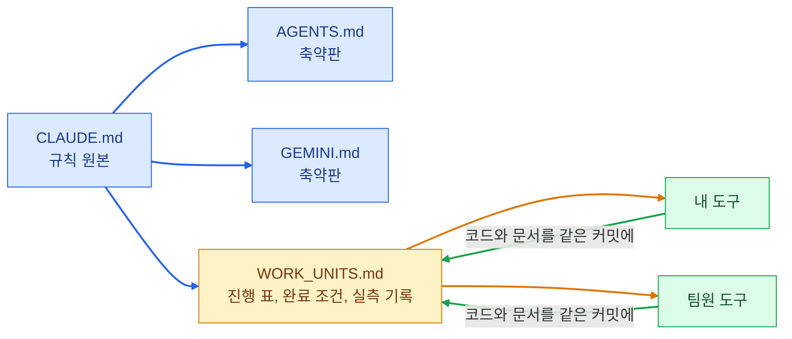

9월 28일부터 10월 2일까지 과정 안에서 바이브코딩 해커톤이 있었습니다. 과제는 "사내 채팅어플 만들기"였습니다.
김송이 님과 둘이 팀을 이뤄 WorkOn이라는 사내 메신저를 만들었습니다.

- 배포 주소: [office-chat-two.vercel.app](https://office-chat-two.vercel.app)
- 저장소: [rome777/office-chat](https://github.com/rome777/office-chat)
- 기술: Next.js, Supabase(로그인, DB, 실시간, 파일 저장), Vercel, OpenAI API

과제는 다섯 단계였습니다. 실시간 채팅 하나에서 시작해 계정과 채널, DM과 첨부와 읽음 표시, 스레드와 검색과 관리자, 마지막에 AI 기능 두 개 이상입니다.
어느 단계에서 멈춰도 배포 주소에서 시연할 수 있어야 한다는 조건이 붙어 있었습니다.

## 만든 것

| 분류 | 기능 |
| --- | --- |
| 기본 대화 | 채널 실시간 채팅, 공개·비공개 채널, 1:1 DM, 파일 첨부 |
| 놓치지 않기 | 메시지마다 안 읽은 사람 수, DM·멘션·스레드 답글 알림 |
| 정리 | 스레드, 내가 볼 수 있는 대화 안에서만 검색 |
| 조직 | 부서 채널 자동 가입, 조직도 |
| 일정 | 캘린더, 회의실 예약 |
| AI | 밀린 대화 요약, 할 일 추출, 말투 변환 |

다섯 단계를 9월 29일에 배포 주소에서 확인했고, 남은 이틀은 조직도와 일정, 회의실 예약을 더했습니다.
닷새 동안 커밋은 205개였습니다.

시연용으로 가상 회사를 하나 만들었습니다. 사업부 2개, 본부 5개, 팀 10개에 직원 37명이 있고, 9월 한 달치 대화 2천여 건과 회의실 8개, 반복 회의가 들어 있습니다.
빈 메신저로는 검색이나 요약을 보여 줄 수 없어서였습니다.

## 둘의 AI 도구가 한 저장소에서 일하는 규칙

둘 다 AI 코딩 도구로 개발했습니다. 사람 둘에 도구 둘이 같은 저장소를 고치는 셈입니다.
첫날 저녁부터 문제가 생겼습니다. 도구가 "완료"라고 보고했는데 문서의 진행 표는 그대로였고, 서로 어디까지 됐는지 알 수 없었습니다.

그래서 규칙 파일을 하나 두고 두 사람의 도구가 모두 그 파일을 따르게 했습니다.

규칙 중에 효과가 컸던 것은 세 가지입니다.

| 규칙 | 생긴 이유 |
| --- | --- |
| 코드를 바꾸는 커밋에는 고친 문서를 같이 넣는다 | 완료 보고와 진행 표가 어긋남 |
| 완료 조건 체크박스가 전부 체크돼야 완료. 무엇으로 확인했는지 괄호로 적는다 | 돌려 보지 않고 완료라고 적음 |
| 고칠 파일의 주인을 먼저 확인하고, 남의 폴더는 가져다 쓰기만 한다 | 같은 파일을 둘이 고쳐 충돌 |

상태 파일을 따로 두지 않은 것도 정한 것입니다. 진행 표 하나만 믿기로 했습니다.

## 화면이 아니라 DB가 막게 한 것

채팅 앱은 "누가 무엇을 볼 수 있나"가 계속 나옵니다. 화면에서 버튼을 숨기는 것으로는 부족합니다. 주소를 직접 치거나 API를 직접 부르면 그대로 통하기 때문입니다.
그래서 권한은 DB의 정책으로 걸었습니다.

| 막은 것 | 확인한 방법 |
| --- | --- |
| 채널 멤버가 아닌 사람의 대화 읽기 | API로 직접 요청해도 0건 |
| 대화 멤버가 아닌 사람의 첨부 파일 열기 | 파일 주소를 알아도 열리지 않음 |
| 확장자만 바꾼 파일 올리기 | 서버가 파일 내용을 보고 거부 |
| 같은 시간에 같은 회의실 두 번 예약 | DB가 거부 |
| 공지 채널에 권한 없는 사람이 글쓰기 | API로 직접 보내도 거부 |

이걸 사람 손으로 매번 확인할 수는 없어서 검사 스크립트로 만들었습니다. 가상 사용자 두 명이 로그인해서 실제로 시도해 보는 방식입니다.

| 검사 | 항목 수 |
| --- | --- |
| 실시간 채팅 (송수신, 재접속, 위조 거부, 익명 차단) | 12 |
| DB 권한 (비회원 거부, DM, 관리자, 이중 예약) | 48 |
| 파일 첨부 (형식, 크기, 권한) | 20 |
| 알림 | 16 |
| 일정 알림 | 15 |
| 회의실 예약 | 24 |

기능을 고칠 때마다 이 검사를 돌렸습니다. 닷새 동안 기능을 계속 얹으면서도 앞 단계가 깨지지 않은 건 이 검사 덕이었습니다.

## AI 기능에 둔 제한

AI 기능은 세 개를 넣었고, 모두 사람이 확인하는 단계를 뒀습니다.

- 요약은 항목마다 원문 메시지로 가는 링크를 붙였습니다. 요약이 틀렸는지 바로 눌러 볼 수 있습니다.
- 할 일 추출은 대화에 담당자나 기한이 없으면 "미정"으로 둡니다. 저장 버튼을 눌러야 남습니다.
- 말투 변환은 "ㅎㅇ"를 신하 말투로 바꿔 주는 장난 기능입니다. 미리 보고 승인해야 전송됩니다.

AI가 쓴 글이 사람 이름으로 그대로 나가는 일은 없게 했습니다.

## 돌아보면

해커톤에서 가장 시간을 쓴 곳은 기능이 아니라 두 가지였습니다. 둘의 도구가 서로의 상태를 알게 하는 문서 규칙, 그리고 고칠 때마다 돌리는 검사입니다.
이 두 가지는 그 뒤 수업에서 에이전트를 만들 때도 그대로 가져다 썼습니다.
