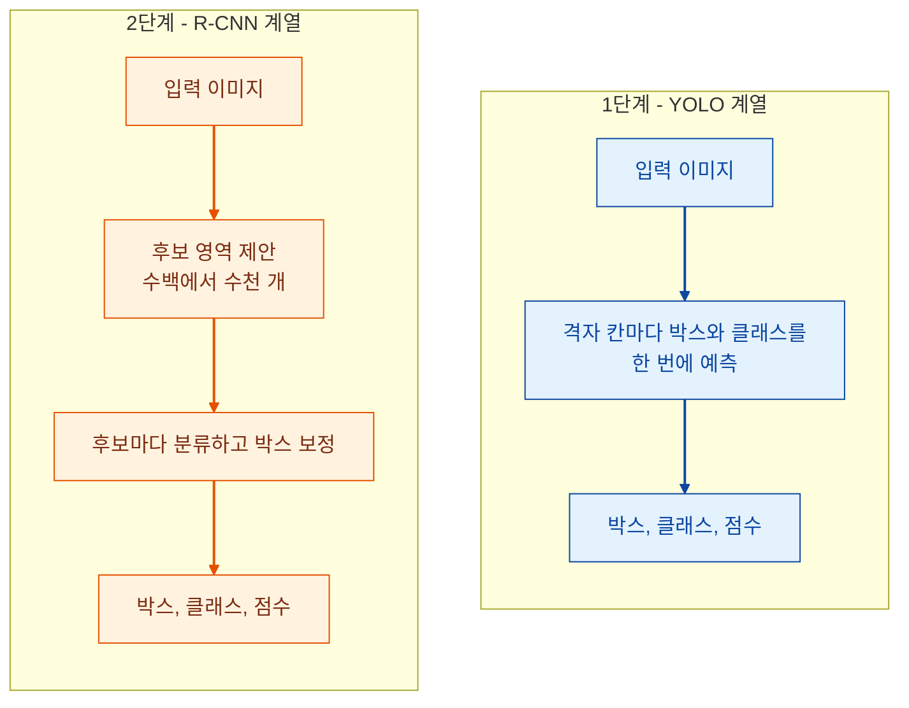
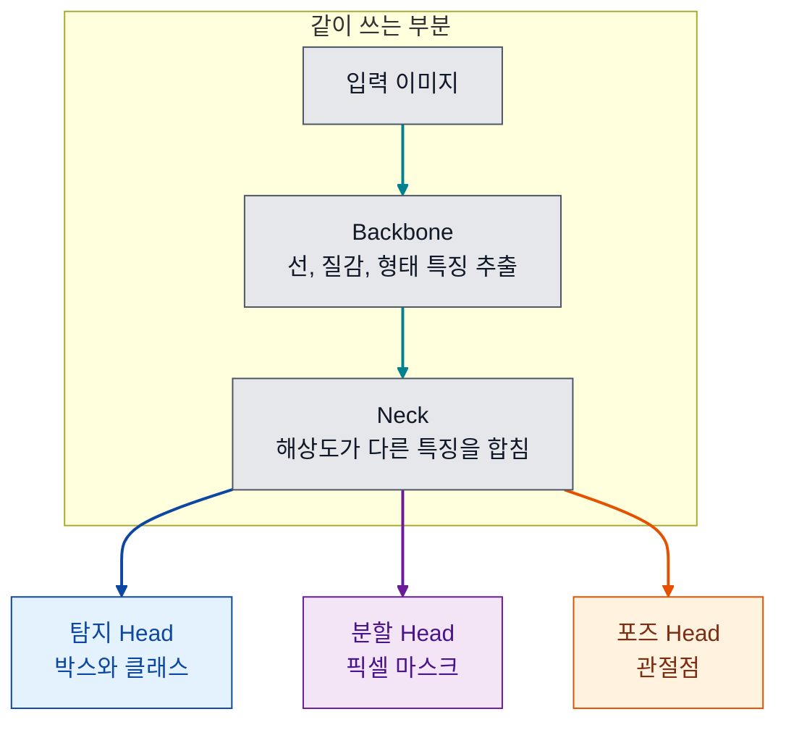

9월에 객체 탐지와 YOLO를 배우고 조에서 발표를 맡았습니다. 버스 사진 한 장에 탐지, 분할, 포즈 모델을 돌리고 임계값을 바꿔 보는 실습도 했습니다.
누가 물으면 바로 답할 수 있게 질문 12개를 고르고, 질문마다 먼저 할 한두 문장을 정해 두었습니다.

읽는 순서는 이렇습니다.

- 왼쪽에 줄이 그어진 칸이 먼저 할 답입니다. 결론부터 말하고, 더 물으면 그 아래 내용으로 이어 갑니다.
- 표에는 이어서 나올 만한 꼬리 질문을 적었습니다.
- 글 끝에 답을 가리고 연습하는 카드가 있습니다.

## 먼저 알아 둘 말

| 말 | 뜻 |
| --- | --- |
| 박스 | 물체를 둘러싼 네모. 좌표 네 개로 적습니다 |
| 클래스 | 사람, 버스처럼 물체의 종류 |
| 신뢰도 | 모델이 박스마다 붙이는 0에서 1 사이의 점수 |
| 특징맵 | 신경망이 이미지에서 뽑아낸 중간 결과. 격자 모양입니다 |
| 손실 | 모델의 답이 정답과 얼마나 다른지 나타내는 값. 학습은 이 값을 줄이는 과정입니다 |
| mAP | 탐지 모델의 정확도를 나타내는 대표 점수. Q9에서 설명합니다 |

## 문제 정의

### Q1. 객체 탐지는 분류와 무엇이 다른가요?

> 분류는 사진 한 장에 이름표 하나를 붙이고, 탐지는 물체마다 위치와 이름을 냅니다. 답이 몇 개일지 미리 알 수 없다는 점이 가장 다릅니다.

창고 사진에서 파렛트는 3개일 수도 17개일 수도 있고, 하나도 없을 수도 있습니다.

| 과제 | 내놓는 답 | 쓰는 때 |
| --- | --- | --- |
| 분류 | 사진 전체에 이름표 하나 | 무슨 사진인지만 알면 될 때 |
| 탐지 | 물체마다 박스와 이름 | 어디에 몇 개 있는지 알아야 할 때 |
| 분할 | 픽셀마다 어느 물체인지 | 넓이나 모양이 필요할 때 |

| 꼬리 질문 | 답 |
| --- | --- |
| 박스로 물체 크기를 잴 수 있나요? | 잴 수 없습니다. 박스는 여기를 보라는 위치 후보입니다. 대각선으로 난 균열을 박스로 감싸면 안쪽 대부분이 멀쩡한 면입니다. 넓이가 필요하면 분할을 씁니다 |
| 그럼 항상 분할을 쓰면 되지 않나요? | 라벨을 만드는 비용이 훨씬 큽니다. 박스는 클릭 두 번이면 되고 마스크는 윤곽을 따라 수십 번 찍어야 합니다. 업무에 필요한 만큼만 고릅니다 |

### Q2. YOLO를 한 문장으로 설명해 보세요

> 이미지를 신경망에 한 번만 통과시켜 박스와 클래스를 동시에 예측하는 탐지 모델입니다. 이름도 You Only Look Once에서 왔습니다.

2016년의 첫 논문은 탐지를 픽셀에서 박스 좌표와 클래스 확률을 바로 계산하는 문제 하나로 다시 정의했습니다.

| 꼬리 질문 | 답 |
| --- | --- |
| "한 번 통과"는 무슨 뜻인가요? | 사진을 신경망 앞쪽에 넣어 끝까지 한 방향으로 한 번만 계산한다는 뜻입니다 |
| 지금 쓰는 YOLO는 첫 YOLO와 같은 것인가요? | 한 번에 본다는 아이디어를 이어받은 별도 구현입니다. 실습에서 쓴 Ultralytics YOLO는 여러 세대의 모델을 파이썬 패키지 하나로 묶은 것입니다 |

### Q3. 2단계 탐지기와 무엇이 다른가요?

> R-CNN 계열은 물체가 있을 만한 후보 영역을 먼저 뽑고, 후보마다 분류하는 두 단계를 거칩니다. YOLO는 후보를 뽑는 단계 없이 한 번에 예측해서 빠릅니다.

첫 논문에 실린 비교입니다.

| 모델 | 정확도 (mAP) | 속도 |
| --- | --- | --- |
| Faster R-CNN | 73.2 | 1초에 7장 |
| YOLO | 63.4 | 1초에 45장 |

빠른 대신 위치 정확도는 낮았습니다. 논문도 위치 오차는 더 많고, 배경을 물체로 잘못 잡는 일은 더 적다고 적었습니다.

| 꼬리 질문 | 답 |
| --- | --- |
| 그럼 YOLO가 항상 좋은가요? | 그렇지 않습니다. 실시간 처리가 필요하면 YOLO 쪽이 맞고, 속도보다 위치 정확도가 중요하면 다른 모델도 봅니다 |
| 두 방식의 결과물은 다른가요? | 같습니다. 둘 다 박스, 클래스, 점수를 냅니다. 그래서 어느 계열인지보다 그 결과를 어디까지 믿을지가 더 중요합니다 |

## 구조

### Q4. YOLO는 박스를 어떻게 예측하나요?

> 이미지를 격자로 나누고, 물체의 중심이 들어간 칸이 그 물체의 박스와 클래스를 예측합니다.

첫 버전은 7×7 격자였고 칸마다 박스 2개와 클래스 하나를 냈습니다. 한 칸이 낼 수 있는 답이 적어서, 새 떼처럼 작은 물체가 몰려 있으면 놓쳤습니다. 이후 버전은 이 한계를 하나씩 고쳤습니다.

| 시기 | 바뀐 것 |
| --- | --- |
| 첫 버전 (2016) | 7×7 격자, 칸마다 박스 2개 |
| v2, v3 | 앵커 박스를 쓰고, 세 가지 해상도에서 예측 |
| v8 (2023) | 앵커 없이 박스를 직접 예측 |
| v10 (2024) | 겹친 박스를 지우는 후처리(NMS)가 필요 없게 학습 |
| YOLO26 (2026) | NMS 없는 추론을 고를 수 있음. 실습에서 쓴 버전 |

| 꼬리 질문 | 답 |
| --- | --- |
| 앵커 박스는 무엇인가요? | 미리 정해 둔 박스 모양 몇 개입니다. 모델은 박스를 처음부터 그리지 않고 앵커와 얼마나 다른지만 예측합니다. 모양은 학습 데이터의 박스를 비슷한 것끼리 묶어서 정합니다 |
| 앵커를 없애면 무엇이 좋은가요? | 데이터가 바뀔 때마다 앵커를 다시 맞출 필요가 없고 출력이 단순해집니다 |

### Q5. Backbone, Neck, Head는 각각 무슨 일을 하나요?

> Backbone이 이미지에서 특징을 뽑고, Neck이 여러 해상도의 특징을 합치고, Head가 박스와 클래스를 냅니다.

탐지, 분할, 포즈 모델은 Backbone과 Neck을 같이 쓰고 마지막 Head만 다릅니다.

| 꼬리 질문 | 답 |
| --- | --- |
| Neck이 필요한 이유는 무엇인가요? | 큰 물체는 해상도가 낮은 특징맵에서, 작은 물체는 해상도가 높은 특징맵에서 잘 보입니다. 둘을 합쳐야 크기가 다른 물체를 함께 잡습니다 |
| 작은 물체가 어려운 이유와 대응은 무엇인가요? | 신경망을 지나며 해상도가 줄어 작은 물체의 정보가 사라집니다. 입력 크기를 키우거나 이미지를 여러 조각으로 잘라 넣습니다 |

## 결과 읽기

### Q6. IoU는 무엇인가요?

> 예측 박스와 정답 박스가 겹친 넓이를, 두 박스를 합친 넓이로 나눈 값입니다. 전혀 안 겹치면 0, 완전히 같으면 1입니다.

IoU는 세 군데에서 씁니다.

| 쓰는 곳 | 하는 일 |
| --- | --- |
| 평가 | IoU가 문턱을 넘으면 맞힌 것으로 셉니다 |
| NMS | 두 박스가 같은 물체를 가리키는지 판단합니다 |
| 학습 | 박스가 얼마나 틀렸는지를 손실로 계산합니다 |

| 꼬리 질문 | 답 |
| --- | --- |
| 몇 이상이면 맞힌 것인가요? | 정해진 값이 없습니다. 0.5를 많이 쓰지만 벤치마크와 업무마다 다릅니다. 위 그림의 0.53은 문턱이 0.5면 정답이고 0.75면 오답입니다 |
| 남의 성능표를 볼 때 무엇을 확인하나요? | 점수보다 그 점수를 잰 IoU 문턱을 먼저 봅니다 |

### Q7. NMS는 왜 필요한가요?

> 같은 물체에 박스가 여러 개 나오기 때문입니다. 점수가 가장 높은 박스를 남기고, 그 박스와 많이 겹치는 나머지를 지웁니다.

1. 박스를 점수가 높은 순으로 줄 세우고 맨 위 박스를 남깁니다.
2. 그 박스와의 IoU가 기준을 넘는 박스를 지웁니다.
3. 남은 박스로 같은 일을 반복합니다.

| 꼬리 질문 | 답 |
| --- | --- |
| 단점은 무엇인가요? | 붙어 서 있는 두 사람처럼 서로 다른 물체의 박스가 많이 겹치면 한쪽이 지워집니다. 후처리라서 시간이 들고 배포할 때 따로 챙겨야 합니다 |
| NMS가 없는 모델도 있나요? | 있습니다. YOLOv10은 물체 하나에 예측 하나만 내는 Head를 함께 학습시켜 NMS를 없앴습니다. YOLO26은 기본 경로에서는 NMS를 쓰고, NMS 없는 추론을 선택할 수 있습니다 |

### Q8. 신뢰도 점수는 정답일 확률인가요?

> 아닙니다. 모델이 학습 때 본 모습과 얼마나 닮았는지를 나타내는 점수입니다. 어디서 자를지는 놓쳤을 때와 잘못 잡았을 때 어느 쪽이 더 비싼지로 정합니다.

| 업무 | 더 피해야 하는 실수 | 임계값 |
| --- | --- | --- |
| 화재, 안전장비 감지 | 놓치는 것 | 낮게 |
| 자동 결제, 문서 승인 | 잘못 잡는 것 | 높게 |

같은 버스 사진에서 임계값만 바꿔 봤습니다.

| 작업 | 0.15 | 0.25 | 0.60 |
| --- | --- | --- | --- |
| 탐지 | 6개 | 5개 | 5개 |
| 포즈 | 5개 | 5개 | 3개 |

탐지는 0.25에서 0.60으로 올려도 그대로였습니다. 남은 다섯 개의 점수가 모두 0.66 이상이라, 0.25와 0.60 사이에 걸린 박스가 하나도 없었습니다.

포즈 모델은 0.15까지 내려도 버스를 잡지 않았습니다. 사람의 관절을 찾도록 학습된 모델이라서, 임계값으로 바꿀 수 있는 일이 아니었습니다.

| 꼬리 질문 | 답 |
| --- | --- |
| 임계값은 어떻게 정하나요? | 정답 라벨이 있는 표본을 작게 만들고 여러 값으로 돌려, 놓친 수와 잘못 잡은 수를 비교합니다. 사진 한 장으로는 정하지 않습니다 |
| 애매한 점수는 어떻게 하나요? | 높은 선 위는 자동으로 처리하고 낮은 선 아래는 버립니다. 그 사이는 사람에게 보냅니다 |

### Q9. mAP는 무엇인가요?

> 임계값을 바꿔 가며 그린 정밀도와 재현율 곡선의 아래 넓이를 AP라고 합니다. 클래스마다 AP를 구해 평균한 값이 mAP입니다.

| 말 | 뜻 |
| --- | --- |
| 정밀도 | 모델이 잡았다고 한 것 중 실제로 맞은 비율 |
| 재현율 | 실제로 있는 물체 중 모델이 잡은 비율 |
| mAP50 | IoU가 0.5를 넘으면 맞힌 것으로 치고 잰 mAP |
| mAP50-95 | IoU 문턱을 0.5에서 0.95까지 올려 가며 잰 값의 평균. 박스가 정확해야 높게 나옵니다 |

| 꼬리 질문 | 답 |
| --- | --- |
| 정밀도와 재현율 중 무엇을 봐야 하나요? | 업무에 따라 다릅니다. 놓치면 안 되는 일은 재현율을, 잘못 잡으면 안 되는 일은 정밀도를 먼저 봅니다 |
| mAP가 높으면 현장에서도 잘 되나요? | 알 수 없습니다. 벤치마크 사진으로 잰 값입니다. 조명이나 각도가 다른 내 데이터로 다시 재야 합니다 |

## 학습과 배포

### Q10. 손실 함수는 무엇으로 이루어지나요?

> 박스 위치가 얼마나 틀렸는지와 클래스가 얼마나 틀렸는지를 따로 계산하고, 가중치를 곱해 더합니다.

| 손실 | 재는 것 |
| --- | --- |
| 박스 | 예측 박스와 정답 박스의 IoU. 중심 사이 거리와 가로세로 비율까지 넣은 변형을 씁니다 |
| 클래스 | 종류마다 맞다, 아니다를 따로 맞히게 합니다 |

버전에 따라 박스 변까지의 거리를 분포로 예측하게 하는 손실(DFL)을 더하기도 합니다. YOLO26은 이것을 뺐습니다.

| 꼬리 질문 | 답 |
| --- | --- |
| IoU를 그대로 손실로 쓰면 안 되나요? | 두 박스가 안 겹치면 IoU가 계속 0이라 어느 쪽으로 옮겨야 할지 신호가 없습니다. 그래서 거리 항을 넣습니다 |
| 첫 버전은 어떻게 했나요? | 전부 제곱 오차였습니다. 물체가 없는 칸이 훨씬 많아서, 박스 좌표 오차는 5배로 키우고 물체 없는 칸의 오차는 절반으로 줄였습니다 |

### Q11. 내 데이터로 학습시키려면 어떻게 하나요?

> 미리 학습된 모델에서 시작해 내 데이터로 이어서 학습시킵니다. 선이나 질감을 알아보는 능력은 이미 있어서, 사진 수백 장으로도 시작할 수 있습니다.

| 단계 | 하는 일 |
| --- | --- |
| 라벨 | 이미지마다 텍스트 파일 하나. 한 줄에 클래스 번호와 박스 중심 x, y, 너비, 높이를 0에서 1 사이 값으로 적습니다 |
| 나누기 | 학습용과 검증용을 따로 둡니다 |
| 학습 | 미리 학습된 가중치를 불러와 시작합니다 |
| 확인 | 검증 데이터의 mAP를 보고, 틀린 사진을 직접 열어 봅니다 |

| 꼬리 질문 | 답 |
| --- | --- |
| 과적합은 어떻게 알아보나요? | 학습 손실은 계속 내려가는데 검증 mAP가 멈추거나 떨어집니다. 그 시점에 학습을 멈춥니다 |
| 라벨을 만들 때 무엇을 조심하나요? | 무엇을 포함하고 뺄지 기준을 먼저 글로 적습니다. 사람마다 기준이 다르면 모델이 그 사이의 어중간한 답을 배웁니다 |

### Q12. 모델 크기는 어떻게 고르나요?

> 필요한 속도와 쓸 수 있는 장비를 먼저 정하고, 그 안에서 가장 정확한 크기를 고릅니다.

Ultralytics 문서에 실린 YOLO26의 값입니다.

| 크기 | 정확도 (mAP50-95) | CPU에서 한 장 |
| --- | --- | --- |
| n | 40.9 | 38.9ms |
| m | 53.1 | 220.0ms |
| x | 57.5 | 525.8ms |

가장 큰 모델은 가장 작은 모델보다 정확도가 16.6 높고 시간은 13배 넘게 걸립니다. 실습에서는 가장 작은 n을 CPU로 돌렸고 한 장에 0.4초쯤 걸렸습니다.

| 꼬리 질문 | 답 |
| --- | --- |
| 배포할 때는 무엇을 하나요? | ONNX나 TensorRT 같은 형식으로 내보내고, 실제로 쓸 장비에서 속도를 다시 잽니다 |
| 서비스에 넣기 전에 확인할 것은 무엇인가요? | 라이선스를 봅니다. Ultralytics는 AGPL-3.0과 기업용 라이선스 두 가지를 두고 있어서, 비공개 제품에 넣는다면 어느 쪽에 해당하는지 먼저 확인합니다. 사람을 찍는다면 촬영 사실을 알렸는지, 사진과 좌표를 어디에 얼마나 두는지도 정합니다 |

## 연습 카드

질문만 보고 30초 안에 소리 내어 답해 본 뒤 답을 열어 맞춰 봅니다. 막힌 질문은 따로 모아 다시 볼 수 있습니다.

  <iframe
    src="/blog/interactive/question-cards.html?post=yolo-questions"
    title="YOLO 연습 카드"
    loading="lazy"
    style="height: 420px"
  ></iframe>

[새 탭에서 열기](/blog/interactive/question-cards.html?post=yolo-questions)

## 출처

- [You Only Look Once: Unified, Real-Time Object Detection](https://arxiv.org/abs/1506.02640)
- [YOLO9000: Better, Faster, Stronger](https://arxiv.org/abs/1612.08242)
- [YOLOv3: An Incremental Improvement](https://arxiv.org/abs/1804.02767)
- [Distance-IoU Loss: Faster and Better Learning for Bounding Box Regression](https://arxiv.org/abs/1911.08287)
- [On Calibration of Modern Neural Networks](https://arxiv.org/abs/1706.04599)
- [Ultralytics 문서: YOLO26](https://docs.ultralytics.com/models/yolo26/)
- [Ultralytics 문서: YOLOv10](https://docs.ultralytics.com/models/yolov10/)
- [Ultralytics 문서: 성능 지표](https://docs.ultralytics.com/guides/yolo-performance-metrics/)
- [Ultralytics 문서: 탐지 데이터셋 형식](https://docs.ultralytics.com/datasets/detect/)
